# Architecture & Reasoning Blueprint — Ingaze Prizm (Engine v2)

- **Team Number & Name:** `Team 12`
- **Team Members:** `Giovanni Pancaldi, Kenessary Uali, Tsegazeab Tamiru Kebede`
- **Chosen Paradigm & Stack (1 line):** *Evidence-backed Typed Knowledge Graph (NetworkX) + 10 deterministic Python tools that **decide**, LLM agents that only **choose / quote / explain**, and rule-based critics that **verify** (FastAPI + Pydantic v2 + OpenRouter / local Mistral-Nemo + React).*

> **One-sentence summary:** *The graph and the tools decide, the agents explain, the critics check.* Every number, phase, verdict and score is computed by Python; the LLMs can only pick among ids they are given, copy verbatim quotes, and write plain-language explanations that are then verified.

---

## 1. Domain Representation & State Design

### 1.1 Core Data Models, Tables, Rules, or State Objects

The domain lives in **three JSON files** and **one typed graph**:

| File | What it holds | Who writes it |
| :--- | :--- | :--- |
| `data/hr_knowledge.json` | The catalog: **18 problem concepts** (with pillar, synonyms, worker-type scope), **16 interventions** (type, allowed workforces, prerequisites, `requires_readiness`, target metrics, problems fixed), metric rules (lower-is-better, aliases), noise markers, ROI benefit lines | Analysts (us) |
| `data/kg_facts.json` | **Evidence-backed links**: 13 cause→effect links, 8 research effect sizes, 3 research thresholds, 1 readiness condition, problem→metric indicators, glossary. **Each link carries a verbatim quote + document id** | Analysts, validated at startup |
| `data/assumptions.json` | Unit costs per action, € per HR hour, CPM (placeholders to calibrate) | Analysts |

Example fact (every cause/effect/threshold looks like this):

```json
{ "id": "K1", "from": "weak_middle_management", "to": "say_do_gap", "strength": 2,
  "mechanism": "Recruiting promises autonomy and growth, but day-to-day management does not deliver it...",
  "evidence": [{ "source": "FN1", "quote": "When recruiting messaging promises high autonomy or rapid growth that contradicts day-to-day team management ... new hires experience an acute Say-Do Gap." }] }
```

**Startup check (`kg.validate_facts`)**: if any quote is not found *verbatim* in its source document, or any id is unknown, the engine refuses to start (`FactError`). Nothing un-sourced can enter the graph.

#### The typed knowledge graph (`backend/v2/kg.py`, `networkx.MultiDiGraph`)

```mermaid
graph LR
  subgraph Reference graph - built once, never mutated
    P[problem<br/>18] -- causes<br/>strength 1-3 + quote --> P
    P -- in_pillar --> PI[pillar<br/>4 + cross]
    P -- indicated_by --> M[metric]
    A[action<br/>16] -- fixes --> P
    A -- needs_first --> A
    A -- fits --> W[worker type<br/>knowledge / logistics /<br/>retail / clinical]
    A -- blocked_by --> CO[condition<br/>readiness_gate]
    P -- closes --> CO
    A -- effect_on<br/>low/high + quote --> M
    R[snippet R1..R10] -- threshold_for<br/>op, value --> M
    C[case C01..C21] -- had_problem --> P
    C -- used --> A
    C -- workers --> W
    C -- changed Δ --> M
    R -- mentions --> P
    F[field note FN1..] -- mentions --> P
  end
  subgraph Client layer - copied per run
    CL[client] -- workforce --> W
    RQ[request:X] -- requests --> A
    SG[segment:site]
    M2[metric + value, peer, status]
  end
```

Every edge has `rel`, `origin` (`catalog` / `reference` / `analyst_mapping` / `client_text` / `client_data`) and `evidence` (list of `{kind, ref, quote}`), so any conclusion can be traced back to a sentence.

**Per-run state** is a chain of Pydantic models (`backend/v2/schemas.py`):

```text
ClientProfile ─► ProblemSignal[] ─► (Diagnosis[], Challenge[]) ─► RootCauseResult ─► CaseRank[]
     │                                                                  │
     └► Gate{action → allowed, earliest_phase, rule, reason, evidence} ─┴► PlanV2[] (ScheduledAction[])
                                     ─► CriticRound[] ─► JurorBallot[] + JuryAudit ─► RoiResult ─► Brief ─► Stability
                                                                         └──────────── ResultV2 (saved to runs/v2/<id>.json)
```

Key objects in one line each:

| Model | Fields that matter |
| :--- | :--- |
| `ProblemSignal` | `measured[]` (worse than peer / over threshold), `healthy[]` (better than peer), `text[]` (verbatim client sentences), `severity 0..1`, `status ∈ {confirmed, text_only, healthy, out_of_scope}` |
| `RootCauseV2` | `role ∈ {root, intermediate, symptom, standalone}`, DEMATEL `drives / driven_by / prominence / relation`, priority `weight` |
| `Gate` | `allowed`, `earliest_phase 1..3`, `rule ∈ {ok, sector_fit, do_not_touch, readiness_gate}`, `evidence[]` |
| `ScheduledAction` | `phase`, `scope`, `fixes[]`, `why_now`, `precedents[]` (cases), `paths[]` (human-readable evidence chain), `original` flag |
| `Source` / `QuoteCheck` | Any claim → `{kind, ref, quote, verified}` |

### 1.2 Representing Cross-Pillar Dynamics, Prerequisites & Sector Guardrails

- **Cross-Pillar Symptom → Root Cause Links:**
  `causes` edges cross pillars on purpose, e.g. `weak_middle_management` (retention) → `say_do_gap` (branding) → `early_attrition` (retention); `manual_tracking` → `cfo_visibility_gap`; `slow_hiring` → `agency_dependency`. For a client, `find_root_causes` takes **only the confirmed problems**, keeps the reference links between them (filtered by workforce scope), adds links the client states in its own text ("Because of X, Y", "X, forcing Y", "driven by"), then runs **DEMATEL** on the strength matrix (`W[i,j] = strength/3`):
  - no incoming links → **root**; no outgoing → **symptom**; both → root if `relation = r − c > 0`, else **intermediate**; no links → **standalone**.
  - priority `weight ∝ prominence × (0.5 + severity)` for roots/standalones only. Symptoms get weight 0, so the plan treats causes, not symptoms.
  - **0 LLM-made links**: the trace prints `"N dataset links, M client-text links, 0 LLM-made links"`.

- **Dependency Prerequisites (`Phase 1 → 2 → 3`):** three independent mechanisms, all deterministic:
  1. **Type floor**: `diagnostic → Phase 1`, `structural → Phase 2`, `amplification → Phase 3`.
  2. **`needs_first` edges** (`prerequisites_any`): e.g. `manager_coaching` and `career_framework` need `internal_listening_360`; `ambassador_tracking` needs `ambassador_selection`. If a prerequisite is missing, the guardrail **auto-adds** it (`decision="added"`); an action is always scheduled at least one phase after its earliest prerequisite. If that would push it past Phase 3 → `deferred_beyond_plan`.
  3. **Readiness gate** (`condition: readiness_gate`, evidence FN4/R5). It is **closed** if any of: say-do gap ≥ 1.1★ (R1), management sub-rating worse than peers, work-life balance worse than peers, or **no readiness data at all** (unknown = closed). Every action with `requires_readiness` (ambassador selection/tracking, technical storytelling) gets `earliest_phase = 3` while closed, `2` if open but no organic advocacy base yet, `1` if open with organic ambassadors.

- **Industry & Workforce Guardrails:** sector is represented as **worker types** (`knowledge_worker`, `frontline_logistics`, `frontline_retail`, `clinical_care`) tagged from the client's `workforce_target`. Every action has `fits` edges, every problem/snippet/case a scope. `gate_action` applies, in order:
  1. `sector_fit` (FN6): e.g. `retail_shift_rotation` only fits retail, `mobile_fast_apply` only frontline/clinical → **blocked** for a FinTech.
  2. `do_not_touch` (FN5): if **all** benchmarked target metrics of an action are already *better* than peers → blocked ("re-engineering healthy foundations wastes budget").
  3. `readiness_gate` (above).
  Context-appropriate actions are **activated automatically** when the profile calls for them, because they are simply allowed by the same edges (e.g. `mobile_fast_apply` appears in the logistics scenario's plan, and is tested).

- **Evidence & Case Study Representation:**
  - **10 research snippets → `R1..R10`**, **21 case studies → `C01..C21`**, field notes → `FN1..` (parsed in `ingest.track_a`).
  - Cases are graph nodes linked by `had_problem` (only problems *named in the challenge text*, not inferred), `used` (per intervention step), `workers`, and `changed` (KPI deltas t0→t12 months from the analytics snapshots → used as ROI precedents).
  - Snippets carry `threshold_for` (e.g. R1: claims gap > 1.1★; R2: form drop-off > 58 %; R3: ≥ 8 manual hours/month) and `effect_on` with low/high ranges (e.g. R2 mobile fast-apply −30…−35 % bounce; R4 listening + coaching −18…−28 % attrition exposure).
  - `doc_links()` precomputes, for every document, which problems/actions it is linked to — used later to remove citations that don't match what a sentence talks about.

---

## 2. Client Intake Parsing, Normalization & Noise Filtering

- **Context Organization Pipeline** (`ingest.build_client` → `tools.load_scenario`), no LLM involved:
  1. Merge scenario + analytics snapshot (+ optional "what-if" overrides via `deep_merge`).
  2. **Metrics**: flatten the t0 snapshot (`public_reputation`, `career_portal_and_funnel`, `social_and_employee_voice`, `hiring_and_retention_kpis`), align with sector peers, compute `status ∈ {better, in_line, worse, no_benchmark}` with a ±10 % tolerance and lower-is-better rules.
  3. **Sites/cohorts**: segment ratings → `weak` (≥ 0.5★ under the best site) / `strong` (≥ 10 % over peer) / `normal`.
  4. **Workforce** tagged by keyword (`tag_archetypes`), declared EVP extracted by regex, annual agency spend parsed from the budget sentence (€/quarter|month|year).
  5. **Healthy baselines** collected (better-than-peer metrics, strong sites, client's "don't break" text).
  6. **Leadership requests** mapped to catalog action ids (`tag_interventions`).
  7. **Readiness** computed once (section 1.2).
  8. A **client layer** is added on a *copy* of the reference graph (values, peers, requests, segments). Self-test asserts the reference graph is never mutated.

- **Concept Normalization / Deduplication:** a deterministic **synonym dictionary** per concept and per action (`map_concept`). E.g. "say-do gap", "expectation drift", "recruiting promises", "EVP mismatch" → `say_do_gap`; "6-month churn" and "early first-year turnover" → `early_attrition`. Matching is scope-aware (a retail-only concept is never matched for a FinTech). `synonym_overrides` removes false friends (e.g. "financial turnover risk" is a turnover cost, **not** `cfo_visibility_gap`). Metric aliases unify keys (e.g. authentic-story ER → `organic_employee_post_er_pct`).

- **Noise Filtering & Anti-Hallucination Controls:**
  | Layer | Check |
  | :--- | :--- |
  | Intake hygiene | Every platform-signal sentence is dropped if it contains a noise marker (`"unverified"`) **or** mentions an action/problem that does not fit the client's workforce (e.g. "shift rotation" in a FinTech dump). Removed sentences are logged with the reason (`NoiseFlag`) and shown in the trace. |
  | Problem detection | A problem is `confirmed` only with metric evidence (worse than peer or over a research threshold). Text-only signals need the diagnostician to agree **and** a verified quote. Strengths/leadership-request text is excluded from problem detection. |
  | Quote verification | `verify_quote`: any quote from an agent must appear **verbatim** (case/space-insensitive) in the referenced field or document, else it is removed. |
  | Scope verification | A cohort/site named by an agent must exist in the client data (`verify_scope`), else → "company-wide". ("Mars Office" is rejected in tests.) |
  | Number ban | Any sentence with a digit written by an LLM is removed (`strip_numbers`); numbers enter text only via `{{tokens}}` rendered by Python. |
  | Pydantic schemas | Every LLM answer must parse into a strict schema; up to 2 repair retries, then fallback model. |
  | Startup | `kg_facts.json` must be 100 % quote-backed or the engine won't start. |

---

## 3. Diagnostic, Prioritization & Action-Planning Mechanism

The pipeline (`backend/v2/pipeline.py`) runs **15 traced stages**. 🟦 = deterministic tool, 🟩 = LLM agent (verified), 🟥 = critic.

```mermaid
flowchart LR
  I[🟦 intake] --> ME[🟦 measure<br/>check_metrics] --> D[🟩 4 diagnosticians<br/>one per pillar] --> SK[🟩 skeptic]
  SK --> RC[🟦 root causes<br/>DEMATEL] --> PR[🟦 precedents<br/>rank_cases] --> G[🟦 gates]
  G --> V[🟦 3 draft plans<br/>greedy cover] --> ST[🟩 strategist] <--> CR[🟥 plan critic<br/>rules + LLM]
  CR --> PL[🟦 final plans<br/>schedule + score] --> FC[🟥 fact-checker] --> J[🟩 jury x5] --> JC[🟥 jury critic]
  JC --> ROI[🟦 ROI] --> S[🟦 stability ledger] --> RW[🟩 report writer<br/>+ validation]
```



### 3.1 Cross-Pillar Root Cause Diagnosis & Healthy Baseline Preservation

1. **Measure (`check_metrics`)**: for each of the 18 problems, compare its indicator metrics to peers and to research thresholds, attach verbatim client sentences, compute `severity` (avg gap + 0.25 per crossed threshold). Problems whose indicators are **better** than peers become `status="healthy"` → listed as **strengths to protect**, never targeted.
2. **Diagnose**: 4 LLM diagnosticians (branding, recruiting, advocacy+cross, retention) run in parallel and say *agree / scope / explanation / quotes* for each candidate. **They cannot add or delete metric-confirmed problems** — disagreement only marks them `contested`.
3. **Challenge**: a skeptic agent looks for counter-evidence. `refuted` requires verified counter-quotes (otherwise downgraded to `weaker`), and can only remove *text-only* problems.
4. **Root causes**: DEMATEL on the evidence-backed sub-graph (section 1.2) → roots vs symptoms + priority weights.
5. **Healthy baselines**: protected twice — as `healthy` signals (never targets) and by the `do_not_touch` gate (actions aimed only at healthy metrics are blocked). Example from the CloudNova self-test: compensation is better than peers → `compensation_review` is blocked, compensation stays untouched.

### 3.2 Guardrail Enforcement, Readiness & Sequencing

- **Gates** are computed for all 16 actions before any plan exists; the strategist only sees `ALLOWED` and `BLOCKED (never use)` lists.
- **Scheduling (`schedule_phases`)**: Python decides every phase = `max(type floor, readiness phase)`, then prerequisite ordering (pulling a prerequisite earlier if needed), then the v1 guardrail `place()` re-validates and records each decision (`kept / moved / added / blocked / deferred_beyond_plan`) with its rule and reason. The LLM never sets phases.
- **Executive requests**: requests from `leadership_perceptions_and_requests` are mapped to action ids and passed through the **same rules** (`place_requests`). The verdict (kept / moved to phase X / blocked) is fixed by rules; the strategist only *explains* it, and the rule critic flags any explanation that contradicts the verdict ("adopt" for a blocked request → blocking issue).
- **Cohorts and sites**: segments are flagged weak/strong; agents can target an action at a named cohort/site, but only if that name exists in the client data.
- **Request checker & what-if** (`steering.py`, deterministic): free-text "can we do X?" → `yes_now / already_planned / later / no` with evidence; pillar priorities (Less ×0.5 / More ×2) re-weight root causes **but never change facts, evidence, guardrails or ROI arithmetic**.

### 3.3 Action Generation (Precedent-Backed + Original) & ROI Grounding

1. **Draft plans (deterministic)** — `canonical_plan`, a greedy set cover of target problems with allowed actions, ranked by (problems covered, same-workforce precedents, −cost). Diagnostics enter as prerequisites, or as fixers only when nothing else fixes a problem. Up to **3 distinct variants** from: `full` (all roots + intermediates), `core` (top-3 roots), `lean` (cheapest cover), `quick` (Phases 1–2 only), or `focus` (client priorities).
2. **Strategist (LLM)** refines each draft: target cohorts, title/thesis, and **≤ 2 original ideas** per plan. An original idea must name problem ids from the root-cause list **and** cite C/R/FN documents that are linked in the graph to those problems and fit the workforce.
3. **Plan critic** (max 1 revision): deterministic `rule_check` (unknown/blocked actions, unjustified drops, missing coverage, unsupported originals, numbers, scope, contradictions) + an LLM critic for what rules can't see (its issues on rule-owned topics are downgraded to advisory). Remaining blocking issues are **auto-fixed by Python** (invalid actions removed, unjustified drops re-added, missing coverage refilled from the graph).
4. **Precedents (`rank_cases`)**: `score = 0.6 × weighted problem overlap + 0.4 × action overlap`, **× 0 if the workforce differs** (FN6). Top-3 worker-fit cases are the matched case studies and the ROI precedents. Each action also gets `paths`, e.g. *"Manager coaching → fixes → Weak middle management (root) · proven in C05 …"*.
5. **Scoring & selection**: deterministic score `0.5 coverage + 0.3 evidence strength + 0.2 ROI efficiency`; 5 jurors (Board, HR Manager, CFO, affected Employee, Candidate) on a mixed model pool score a 1–5 rubric with **rotated plan order**. The **jury critic** halves votes that cite nothing from the plan or contradict their own scores, down-weights outliers, detects position bias. Final = `0.5 jury + 0.5 deterministic`; if the top two are within 0.03 the deterministic score decides (stability).
6. **ROI (pure arithmetic, `metrics.roi`)**: 4 benefit lines — attrition exposure, agency spend, manual HR hours, earned media value — each `client base value × KPI delta observed in the matched precedents`, expected (mean) and conservative (worst) case, minus unit costs from `assumptions.json`. Payback and ROI % are computed, never written by an LLM.
7. **Discovery questions / confidence**: each accepted problem gets a confidence level (`high/medium/low`) from counts of metric evidence, text evidence, literature and precedents; low-confidence and contested items are what the client should be asked about next.
8. **Brief**: the report writer receives facts with numbers replaced by `<number>` and may use only `{{tokens}}` (cost, benefit, payback, roi, `compare:<metric>`). Each sentence is validated (no stray digits, known citations only, a `compare` token only in a sentence about that metric). Then the **fact-checker** (layer 1: citation grounding against the graph; layer 2: a different model family marks sentences supported/unsupported/contradicted → removed). If the writer fails, a **deterministic template** brief is used. Three reader versions: HR Manager / CFO / Board.

---

## 4. Tech Stack & Production Trade-Offs

| Layer | Chosen Tool / Library | Why We Picked It Over Alternatives |
| :--- | :--- | :--- |
| **Data / State Layer** | JSON knowledge files + **NetworkX `MultiDiGraph`** (in memory) + **Pydantic v2** models; run results as JSON in `runs/v2/` | Small, curated domain (18 problems, 16 actions, 31 documents): an in-memory typed graph is instant, versionable in git and needs no DB server. Multi-edges let one pair carry several sourced relations. A graph DB (Neo4j) would add ops cost with no query we need. |
| **Reasoning / Planning Layer** | 10 pure Python tools (`tools.py`): threshold checks, **DEMATEL** (NumPy), greedy set cover, rule-based gating/phasing, precedent ranking, ROI arithmetic | Deterministic and testable: same input → identical output (asserted in self-tests). DEMATEL gives a standard, explainable cause/effect split instead of an LLM "opinion" about root causes. |
| **LLM / Parsing Layer** | OpenAI-compatible client → **OpenRouter** (remote roles: strategist, writer, some jurors) + **local Mistral-Nemo via Ollama/Colab** (diagnosticians, skeptic, critic, fact-checker); temperature 0, seed 7, JSON-schema output | Two model families so the fact-checker is independent of the writer; automatic cross-tier fallback when a quota or GPU is down; **cache keyed by role + prompt + schema (not model)** so a fallback model can't change a repeated answer. Every agent degrades to the rule-based result if all models fail. |
| **Validation / Testing** | `kg.validate_facts` at startup; `backend/v2/selftest.py` (no network); stability ledger (`consistency.py`) | Self-tests cover: fake quote rejected, graph never mutated, determinism of all tools on 3 scenarios, guardrail expectations, and a **deliberately misbehaving fake LLM** (invented quotes, sites, numbers, actions, a "hire_a_wizard" action, hallucinated sentences) — all must be caught. Ledger hashes input + KG version + prompts and reports if an answer ever changes. |
| **API / UI** | FastAPI (`/api/v2/runs`, `/whatif`, `/check-request`), React + Vite + Tailwind + Recharts, jsPDF export | Async stages stream progress to the UI; v1 engine stays as a fallback toggle. |

### Why Our Architecture Works Best

1. **Compared to a Flat Single-Prompt LLM / Naive Vector RAG** *(concrete behaviours pinned by our self-tests and demo on `SCENARIO_A_CLOUDNOVA_FINTECH`)*:
   - **Sector contamination**: a FinTech dump containing retail text would make a flat LLM suggest shift rotation. We block `retail_shift_rotation` and `mobile_fast_apply` by `sector_fit` (FN6), and the sentence is removed at intake.
   - **Sequencing**: with a 1.3★ claims gap (> R1's 1.1★ threshold), ambassador actions are forced to **Phase 3**, and `internal_listening_360` always comes before `manager_coaching`. Live tweak: set the claims gap to 0.3 and management to 3.6 → the gate opens and ambassador actions move earlier. A single prompt has no such rule to obey reliably.
   - **Healthy baselines**: compensation is better than peers → `compensation_review` is blocked (`do_not_touch`), even when the LLM proposes it.
   - **Root cause vs symptom**: `weak_middle_management` = root, `early_attrition` = symptom (DEMATEL), so money goes to coaching, not to fighting attrition directly. Vector RAG retrieves similar text but has no notion of direction or prerequisites.
   - **Hallucinations**: invented quotes, sites ("Mars Office"), numbers ("40 %"), unknown citations ([Z99]) and unsupported claims are all removed — verified by the fake-LLM test. RAG would pass them straight into the report.
   - **Cross-workforce precedents**: a case with a different workforce scores 0, so the Top-3 cases always match the client's reality.

2. **Compared to Alternative Paradigms We Considered:**
   - **Fully agentic (LLMs plan and decide)** — flexible but non-deterministic, expensive (many long calls) and hard to audit. We kept agents only where language helps (explaining, targeting cohorts, original ideas) and made them unable to change numbers, phases or verdicts.
   - **Pure rule engine (no LLM)** — deterministic but cannot read nuanced client text, propose client-specific ideas, or write a readable brief. Our system still **runs entirely without LLMs** (every agent degrades to the rule result), so it is a strict superset.
   - **Relational scoring matrix only** — scores actions but cannot express causal chains, prerequisites or "why" paths; our graph gives both scores and traceable paths.
   - **Engineering trade-offs**:
     - *Determinism*: temperature 0 + seed + role-keyed cache + stability ledger → same data, same answer.
     - *Token cost / latency*: tools are instant; LLMs get compact, pre-computed messages; cached runs cost zero tokens; heavy roles run locally.
     - *CFO auditability*: every € comes from a visible formula (`base × precedent Δ − unit cost`) with the cases cited; every recommendation has a `why_now`, a rule, and an evidence path back to a verbatim quote.
   - **Honest limitations**: synonym matching can miss unusual phrasing (no embeddings in v2); unit costs are placeholders to calibrate with Ingaze; the knowledge graph must be curated by hand when new research or cases are added (startup validation makes this safe but not automatic); ROI precedents are averages of past cases, not forecasts.
